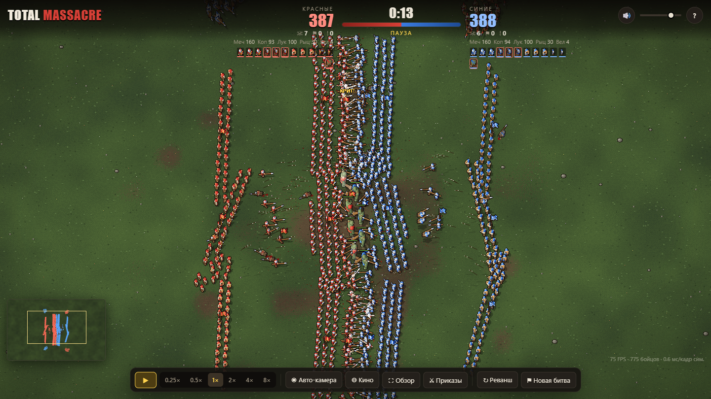

# TOTAL MASSACRE

A browser sandbox for mass medieval battles. You build two armies, pick their formations and
watch them fight on their own: hundreds or thousands of pixel-art soldiers organised into
regiments, with morale, stamina, volleys, cavalry charges and giants.



The game runs entirely in the browser with no build step and no server. The interface is in
Russian.

## Running

Open `index.html` in Chrome, Edge or Firefox. That is all.

If the browser blocks local files, serve the folder with any static server, for example
`npx serve .` or `python -m http.server`.

## Features

- **Five unit classes** with distinct roles: swordsmen (shields block arrows), spearmen (brace
  against cavalry), archers (volley fire, skirmish back), knights (lance charges) and giants
  (sweeping club blows that throw men into the air).
- **Regimental AI.** Armies are split into regiments that keep their ranks, fill gaps from the
  rear, advance as one line, hold reserves, flank, charge and withdraw. Each arm follows its own
  doctrine: pike walls, timed volleys, the cavalry cycle of flank, charge, withdraw and re-form.
- **Morale and panic.** Losses, wounds, flank attacks and terror spread through the ranks; whole
  regiments break and rout; an army that runs entirely loses.
- **Stamina.** Running, charging and fighting tire soldiers; tired men are slower and strike less
  often. Long melees wear both sides down, and kiting has a natural limit.
- **Army editor.** Sliders, scenario presets and five formations (line, phalanx, wedge, horde,
  manual). In manual mode every group is placed, rotated and dragged by hand and fights as its
  own regiment.
- **Procedural pixel art.** Every sprite is generated at load time from small 3D models, in
  16 directions and several detail levels for zooming out.
- **Battle presentation.** Regiment standards, arrow volleys with shadows, dust and impact
  effects, a cinematic auto camera, a minimap, an event feed that jumps to the action, a tactical
  overlay of regiment orders and a result screen with a chart of the battle.
- **Recorded sound** (CC0) mixed with Web Audio: clashing blades, volleys, charges, war horns
  and a battle ambience that follows the fight.
- **Deterministic simulation.** The same seed always produces the same battle.

## Controls

| Key | Action |
|---|---|
| `Space` / `Enter` | start the battle; `Space` also pauses |
| `1`–`4`, `[` `]` | simulation speed (0.25× to 8×) |
| `C` | auto camera |
| `V` | cinematic camera |
| `F` | show the whole field |
| `T` | tactical overlay (regiment orders) |
| `N` | toggle the minimap |
| `R` | rematch with the same armies |
| `Esc` | back to army setup |
| `M` | mute |
| `H` | help |
| `WASD` / arrows, mouse drag | move the camera |
| mouse wheel, `+` `−` | zoom |
| click a soldier | follow him |
| `Q` `E`, `Del`, right click | rotate / delete a group in the manual editor |

Clicking a line of the event feed, a regiment badge under the score or the minimap moves the
camera there.

## Technology

- Plain JavaScript (ES2020), HTML Canvas 2D and the Web Audio API.
- No dependencies and no build: the scripts share one global `TM` namespace instead of ES
  modules, so the game also works from `file://`. Sounds are bundled into `js/sound-data.js`
  as base64 for the same reason.
- Fixed 60 Hz simulation step with a seeded random generator. Visual effects and sound use a
  separate random source, so they never change the outcome of a battle.

## Project structure

```
index.html            page layout and script loading
css/style.css         interface styles
js/config.js          world settings, unit stats, formations, scenario presets
js/utils.js           seeded random generator, math helpers
js/spatial.js         spatial hash grid
js/formations.js      starting positions of the automatic formations
js/editor.js          manual army editor
js/units.js           soldier behaviour: perception, morale, stamina, fighting in the ranks
js/tactics.js         regiments, orders by arm, army command, regiment morale
js/battle.js          simulation step, physics, combat resolution, statistics
js/sprites.js         procedural sprite generator
js/effects.js         particles, impact effects, ground decals
js/render.js          renderer
js/camera.js          camera, auto and cinematic camera
js/audio.js           sound engine
js/sound-data.js      generated sound bundle (do not edit)
js/ui.js              interface, HUD, event feed, minimap, results
js/main.js            game loop and input
assets/sounds/        processed sound files, manifest and credits
tests/                automated tests
tools/                sprite sheet viewer, sound board, sound bundle builder, sound pipeline
```

## Tests

The tests need Node.js 22 or newer; the browser and sound tests also need Chrome or Edge (set
`CHROME_PATH` if it is not found). Nothing has to be installed with npm.

```
npm test                  # all suites
npm run test:sim          # simulation: determinism, tactics, morale, stamina, performance
npm run test:browser      # end-to-end in headless Chrome: interface, editor, camera, sound
npm run test:audio        # offline render of real battles through the sound engine
```

Developer URL parameters such as `index.html?preset=1&start=1&skip=15&seed=42&zoom=1.5` start a
scenario directly; see `debugParams` in `js/main.js`.

## Credits and license

All sound effects are CC0 recordings from Kenney, OpenGameArt and Freesound; sources and authors
are listed in [assets/sounds/CREDITS.md](assets/sounds/CREDITS.md).

The project code does not have a license yet.
